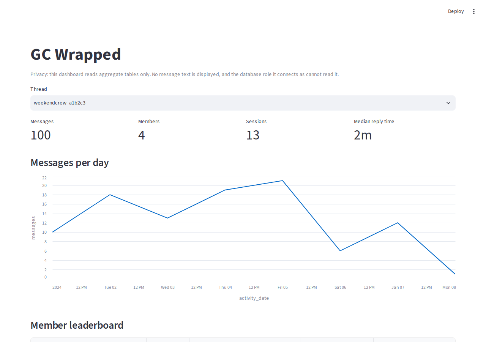

# GC Wrapped

Group chat analytics platform: chat exports go into a Postgres warehouse (dbt), get enriched by an LLM, power RAG Q&A with citations, and produce a "Wrapped" profile per member.

Status: Phase 2 (enrichment + evals) has started. Phase 1 is done: parser, Postgres loader, dbt models, the Airflow DAG, the dashboard and `make e2e`. The per-sender consent ledger is in. See [docs/STATUS.md](docs/STATUS.md).

## Architecture

TBD. Planned flow: export file → parser → Postgres `raw` schema → dbt models → Airflow landing-zone DAG → dashboard. Design rationale lives in [docs/decisions.md](docs/decisions.md).

## Quickstart

Requires Docker with compose, make, and (for the synthetic data generator and tests) [uv](https://docs.astral.sh/uv/). Everything below uses synthetic data in the `gcw_dev` database.

```
git clone https://github.com/ryanphan07/GC-Wrapped.git && cd GC-Wrapped
cp .env.example .env                  # then change POSTGRES_PASSWORD and GCW_READER_PASSWORD
uv sync
uv run python tests/synthetic/instagram.py --out data/landing   # synthetic exports, one subfolder each
make e2e                              # db + dashboard up, Airflow DAG once, counts printed
# open http://localhost:8501
```

`make e2e` starts Postgres and the dashboard with compose and waits until both are healthy, then runs the Airflow DAG once inside the Airflow container (`check_landing → migrate → ingest → dbt build → summarize`). It prints the target database name, the counts from `gcw last-run` and the dashboard URL, and exits non-zero on any failure. Running it again is safe: ingest is idempotent, so a second run inserts 0 rows. CI runs this exact command twice on synthetic data and asserts the second run inserted nothing.

`make e2e` reads the env file named by `ENV_FILE` (default `.env`). **`GCW_DB_NAME` is the single variable that decides the target database** for gcw, dbt and the dashboard. `DATABASE_URL` is optional; if set, it must name the same database or gcw refuses to start. See `.env.example` for every variable.



*The dashboard on the synthetic export (`gcw_dev`). All names, threads and counts are generated; no real chat data.*

Development:

```
uv sync --all-groups
make lint test
make test-integration       # needs the db container up; resets raw in gcw_dev
make e2e                    # rebuild the marts after test-integration, then:
make test-warehouse         # needs the marts from a fresh e2e
make dbt-debug
```

## Usage

These commands connect to the database named by `GCW_DB_NAME` (with `POSTGRES_USER` / `POSTGRES_PASSWORD`, from the environment or `.env`), and print the target database name first so you can see where you are writing.

```
gcw migrate                 # create/upgrade the raw schema (idempotent)
gcw ingest PATH [PATH ...]  # parse export root(s) and load them into raw.messages
gcw parse PATH [PATH ...]   # parse only, print counts; no database needed
```

- **`gcw migrate`** applies the numbered files in `migrations/` that are not yet recorded in `schema_migrations`, in order, each in its own transaction. Running it again applies nothing. Run it once per database before the first `ingest`.
- **`gcw ingest`** parses one or more export roots, then loads them in a single transaction. It prints counts only: rows parsed, rows inserted, duplicates skipped, elapsed seconds. Re-ingesting a file, or an export that overlaps an earlier one, inserts only the new messages (first write wins). Every run is recorded in `raw.load_runs` with its status and counts; a failed run leaves no partial messages.

## Airflow

A daily DAG, `gcw_pipeline`, runs `check_landing → migrate → ingest → dbt_deps_and_build → summarize` over a landing directory. Each export is one subfolder of that directory. Tasks only call the `gcw` CLI and dbt, and both log counts, never message content.

Run it locally (Docker needed; the DAG itself is verified in CI):

```
mkdir -p data/landing                    # drop export folders in here, one subfolder per export
make airflow-up                          # builds airflow/Dockerfile, starts db + Airflow
# open http://localhost:8080, unpause gcw_pipeline, trigger it
```

- `GCW_LANDING_HOST_DIR` chooses which host folder is mounted (read-only) at `GCW_LANDING_DIR` in the container; it defaults to `data/landing`.
- The database comes from `GCW_DB_NAME` in the container's environment (set from the env file), not from Airflow connections; dbt reads the same variable.
- To run it once without the UI, use `make e2e`.
- CI builds the image, runs the DAG tests inside it, runs `airflow dags test gcw_pipeline` against a Postgres service, and runs `make e2e` twice in a separate `e2e` job.

**Why Airflow and dbt use separate environments.** Airflow pins a large set of dependencies with a constraints file, and dbt's own dependencies often conflict with those pins. The image therefore keeps Airflow in its own Python environment and installs `gcwrapped` and dbt into a second virtualenv, `/opt/gcw-venv`, built from `uv.lock`. Tasks run that venv's `gcw` and `dbt` binaries as subprocesses, so neither side can break the other when it upgrades.

## Dashboard

A Streamlit app shows activity from the `analytics` marts: KPIs, messages per day, a member leaderboard and an hour-of-day chart, per thread. It connects as `gcw_reader`, a read-only role that can read mart tables in `analytics` and has no access to the `raw` or `staging` schemas (staging and intermediate models), so message text cannot reach it.

```
# .env needs GCW_READER_PASSWORD (the role is created on first `make up`, from docker/postgres/init/02-reader-role.sh)
# Run the pipeline first so the marts exist (ingest + dbt build); dbt grants the role its access.
make dashboard-up           # http://localhost:8501 (`make e2e` also starts it)
make test-warehouse         # query tests, permission-denied checks, Streamlit AppTest (after dbt build)
```

If your Postgres volume already existed before this change, the init script will not rerun: run `bash docker/postgres/init/02-reader-role.sh` inside the db container once.

## Running on real data

Real data gets its **own compose project**: its own containers, its own Postgres volume and its own superuser password, so the dev credentials in the repo's `.env` cannot reach it. Real exports and the real-data env file live outside the repo; you pass the file as `ENV_FILE`. The env file sets:

- `COMPOSE_PROJECT_NAME=gc-wrapped-real` (overrides the pinned `name: gc-wrapped`; every make target passes `--env-file "$(ENV_FILE)"`, and make also reads that file instead of `.env`)
- `GCW_DB_NAME=gcw_real`
- its own `POSTGRES_USER`, `POSTGRES_PASSWORD` and `GCW_READER_PASSWORD`, different from `.env`
- `GCW_LANDING_HOST_DIR`: an absolute path to a folder with one subfolder per export (mounted read-only into the Airflow container as `GCW_LANDING_DIR`)
- `POSTGRES_HOST_PORT` and `DASHBOARD_PORT`, different from the dev stack's (5432 and 8501); `make real-ingest` requires this
- `GCW_THREAD_ALLOWLIST`: the numeric thread IDs you have consent to ingest (ingest fails without it)
- `GCW_LOG_DIR`: an existing directory outside the repo for the private full log (written by the host-side `make real-ingest`; not passed to containers)

Run these in your own terminal, never through a coding assistant:

```
make check-landing ENV_FILE=<ENV_FILE>   # counts only: folders by shape, allowlisted IDs found
make real-ingest ENV_FILE=<ENV_FILE>     # guards, check-landing, e2e; allowlisted summary lines only
# ...look at the dashboard, then stop the real stack:
make down ENV_FILE=<ENV_FILE>
```

Host-side `gcw` commands read settings from the file named by `ENV_FILE` only (plus the process environment), never from the repo's `.env` unless that is the file named. An env file must therefore be complete.

`make real-ingest` refuses to start unless the env file is not `.env`/`.env.example`, names its own compose project and ports, sets `GCW_DB_NAME` to something other than `gcw_dev`, has a valid non-empty allowlist, and has an existing `GCW_LOG_DIR` outside the repo. The terminal output has a `== step: ... ==` header per step; a few lines (such as `rows inserted` or `elapsed seconds`) appear twice because the Airflow task log and the plain command each print them, which is expected. `make e2e ENV_FILE=<ENV_FILE>` still works for the pipeline alone, with the same allowlist requirement but without the guards or the filtered output.

The real stack is started only for a run and stopped afterward. A fresh volume runs the reader-role init script itself, so no manual step is needed. Output is counts and the database name only. Re-running after adding a newer export to the landing folder loads just the new messages.

## Privacy

Real chat data is sensitive, and the AI coding assistant used on this repo is a third-party API. The rules:

- **Consent.** Only chats whose members have agreed to be analysed go through the pipeline. Anything shown to someone other than the repo owner needs the same agreement.
- **Consent allowlist.** Ingestion is deny by default. It loads only threads whose numeric thread ID is listed in `GCW_THREAD_ALLOWLIST`, and fails if the list is unset or empty. Threads are picked by folder name before any file inside is opened, so a chat that is not on the list is never read into memory. There is no bypass switch: dev, CI and real env files all list their IDs. `make check-landing` shows, as counts only, how many folders match.
- **Survey tools read every thread.** `make inspect` and `make parse-check` read the whole local export to validate the format, print aggregates only and store nothing. They are not gated by the allowlist, so non-consented chats are read locally, in memory, for counts. Anything that loads data is gated.
- **Private real-run logs.** `make real-ingest ENV_FILE=<path>` writes the full pipeline output to `GCW_LOG_DIR` (outside the repo, mode 0600) and prints only lines that fully match a fixed set of label-and-number patterns. The log is never pasted anywhere.
- **Two gates, both deny by default.** The thread allowlist above gates *ingestion*. A second, per-sender consent ledger gates *external processing*: whether anyone's text may ever be sent to a model or other outside service. It is a CSV outside the repo (`GCW_CONSENT_LEDGER`) with one row per (thread, sender display name) and a consent of `yes`, `no` or blank. A blank means no, and a sender missing from the ledger means no, so a missing answer never sends anyone's text. `make consent-template` creates or extends the ledger from the warehouse (new rows start blank; existing answers are never changed or deleted). `make consent-load` validates the whole file and loads it all-or-nothing into `raw.sender_consent`. One dbt model, `fct_message_eligibility`, is the single definition of which messages may leave the machine: only those whose sender is `yes` in that thread. Both targets print fixed labels and counts, never a name or the ledger path.
- **Redaction comes before any API call.** No message text leaves the machine except through a redaction step (planned, decision D70; not built yet), and only for messages that pass the consent gate. Nothing in the pipeline calls an external API today.
- **Text never leaves staging.** Message text exists only in `raw` and the staging models. The marts the dashboard reads carry counts and timestamps, no content.
- **Reader role.** The dashboard connects as `gcw_reader`, a read-only Postgres role with `SELECT` on mart tables only. CI asserts permission-denied on `raw` and staging.
- **Content-free logs and errors.** Logs, CLI output and stored error summaries carry counts, IDs, durations, file hashes and exception class names, never message text, sender names, phone numbers or emails. Sentinel tests enforce this.
- **Coding-agent isolation.** The assistant never reads, prints, searches, or lists anything under `data/` or the real env file, and only connects to `gcw_dev` (synthetic data). `gcw_real` is for the repo owner alone; real-data commands are run in the owner's terminal and only aggregate numbers are shared back.
- **Unhandled errors.** `gcw` prints `gcw: failed: <ExceptionTypeName>` and exits 1, never the message or a traceback. `GCW_TRACEBACK=1` restores the traceback: dev only; never set on real-data runs.
- Chat data, media, `.env` files, and `members.yaml` are never committed. `data/` is git-ignored.

## Metrics

See [METRICS.md](METRICS.md). Every number there comes from a recorded run, with its source and date.
