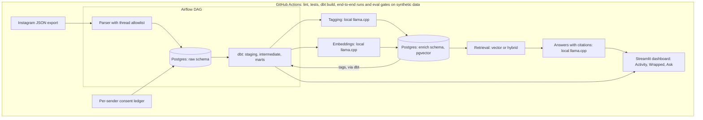
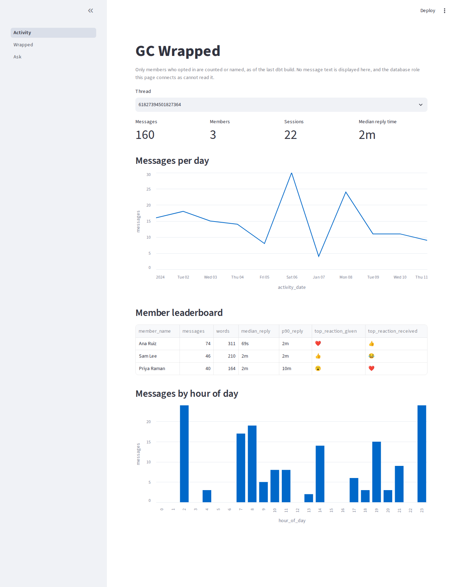
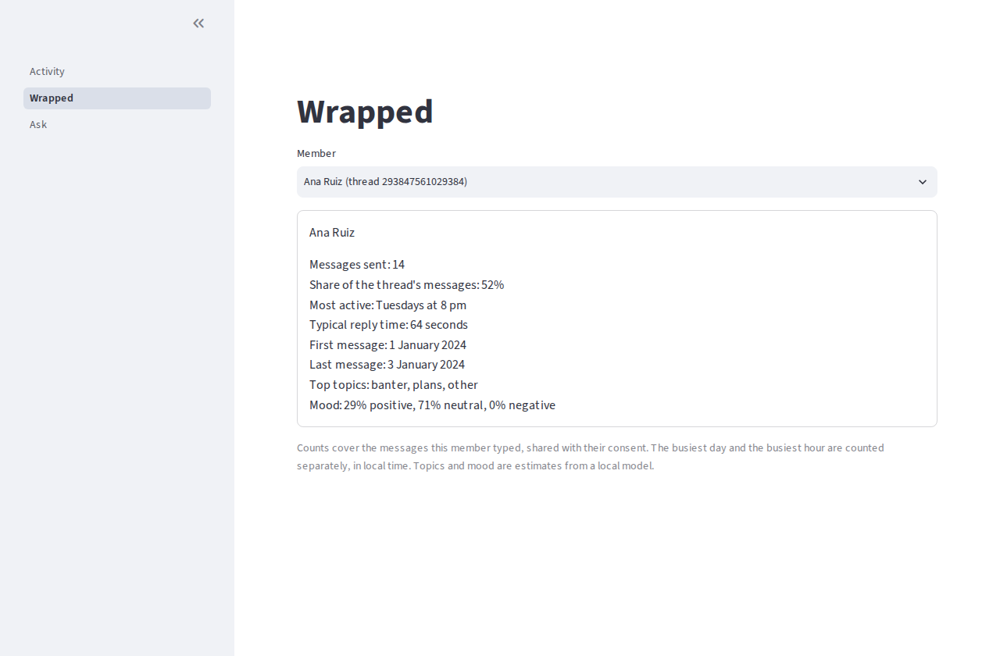
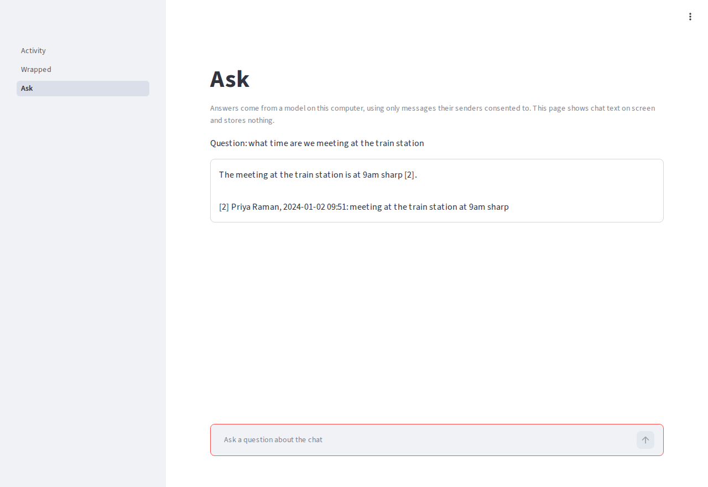

# GC Wrapped

GC Wrapped turns an Instagram group-chat export into a Postgres warehouse (dbt), tags messages by topic and sentiment, answers questions about the chat with citations to the source messages, and shows the result in a Streamlit dashboard: chat activity, a per-member "Wrapped" card and an Ask page. All model work runs on one machine with llama.cpp, model work on message text needs each sender's opt-in, and model and retrieval choices are measured against eval rules written down before the runs. It is a local application: nothing is deployed, and the quickstart runs on synthetic data.

## Architecture



Business logic lives in the `gcwrapped` Python package. Airflow tasks only call its `gcw` CLI and dbt, so everything also runs and is tested without Airflow. The Airflow image keeps `gcwrapped` and dbt in their own virtualenv, built from `uv.lock`, so their dependencies cannot conflict with Airflow's pins. The reasons behind each design choice are in [docs/decisions.md](docs/decisions.md); the `D<n>` references below point there.

## Pipeline

1. **Parse.** The parser reads Meta's "Download your information" JSON export ([format spec](docs/formats/instagram-schema.md)). It repairs Meta's text encoding and otherwise stays faithful to the source; cleaning happens in dbt. Only threads on the allowlist are opened.
2. **Load.** SQL migrations create the schema. Messages are bulk-copied into `raw.messages` in one transaction, keyed by a hash of fields that do not change between exports. Re-ingesting the same or an overlapping export inserts only new messages, and every run is recorded in `raw.load_runs`.
3. **Model.** dbt builds staging views, an intermediate model for conversation sessions, turns and reply time, and the marts, with data tests and unit tests. The marts hold no message text. The dashboard's read-only role is granted selected mart relations only.
4. **Orchestrate.** The `gcw_pipeline` DAG runs `check_landing`, `migrate`, `ingest`, `dbt_deps_and_build` and `summarize` over a landing folder with one subfolder per export. An optional tagging task runs after the dbt build when a local model URL is configured. `make e2e` starts the database and dashboard and runs the DAG once.

## Enrichment and evals

**Tagging.** Each consented, user-typed message gets one topic and one sentiment from fixed lists. The local model sees the message and a little preceding context, and its output is constrained by a JSON schema (D85, D89). Placeholders that Instagram generates itself, such as "liked a message", are filtered out by one dbt model whose patterns are a seed (D95).

**Tag eval.** `make tag-eval` runs one model over a hand-labeled set (one annotator), stores its predictions without message text, and reports accuracy and macro-F1 with bootstrap confidence intervals. `make tag-compare` applies a non-inferiority rule: a faster challenger replaces the default only if it is faster by a set factor and the paired interval shows it is not worse than a set margin on either task (D92, D93, D98). `make tag-promote` refuses a model the latest verdict did not name.

**CI gates.** Every push and pull request runs the production prompt and client with a very small Qwen3.5 model over committed synthetic labels, and the production window builder, embedding model and vector search over committed synthetic questions. The build fails if a score drops below the floor committed in `tests/fixtures/eval/`, or if a retrieval question is dropped (D100, D108). A pass shows that the pipeline works, not that quality on real chats holds.

**Pre-registered win rules.** Both rules were written before the runs they judge, and both keep the baseline unless the variant clears every condition. Either way the verdict is recorded, and the matching promote command refuses anything the latest verdict did not name.

- Retrieval (D104): hybrid replaces vector only if the paired bootstrap interval of the per-question recall@k difference lies entirely above zero and hybrid's tail latency stays under a fixed limit.
- Answer prompt (D121): the one variant prompt replaces the baseline only if the paired bootstrap interval of the citation-hit difference lies entirely above zero and its failure rate and tail latency stay within fixed margins of the baseline's.

**Intervals.** Single rates over questions (recall@k, citation hit, abstentions, failures and so on) use Wilson score intervals, which do not collapse to a point when every question passes or fails. MRR and the paired comparisons use the bootstrap (D117).

**Hand grading.** The automatic answer eval can tell whether an answer cites a correct source message, not whether the answer is right. `make grade-answers` shows regenerated answers and their citations in the terminal, in a fixed seeded order; the grader marks each correct, partial or wrong, and whether the citations support it. Only grades, IDs and numbers are saved. `make grade-summary` reports accuracy, precision and support with Wilson intervals (D120).

`make eval-all` runs the retrieval and answer evals and comparisons in order and stops at the first failure; on real data it also promotes the winners (D122).

**Clean runs only.** Every retrieval and answer eval pass reads the host's memory, prints available memory and swap in use at its start and end, and refuses to start, or fails and stores nothing, when swap use crosses the fixed limits, so `eval-all` stops before any comparison or promotion and the whole run is repeated. Each answer eval pass starts a new model server. `answer-eval` and `ask` also count invalid outputs per fixed reason, as a diagnostic only (D126).

## RAG

- **Message windows.** Each eligible message gets one vector, computed from that message plus its eligible neighbors in the same thread and conversation session, one `sender: text` line each (D103). Short replies carry little meaning alone, and one vector per message keeps eval gold and citations at message level. A local Qwen3 embedding model produces the vectors, stored in pgvector and searched exactly, with no approximate index.
- **Vector and hybrid.** Vector search ranks windows by cosine distance. Hybrid fuses that ranking with a Postgres full-text ranking over the same window text by reciprocal rank fusion (D104). Vector is the default unless a comparison promotes hybrid (D110).
- **Consent at query time.** A stored vector is searchable only if its message and every message in its window are eligible now, so a revocation applies before anything is deleted.
- **Grammar-constrained citations.** The messages of the top results are read again, grouped into excerpts and numbered. llama.cpp compiles a JSON schema into a grammar, so the model can only cite numbers it was shown, and it must decide whether it can answer and what it cites before writing the text. The code rejects an answer with no citations or with a marker that is not in its citation list; an abstention prints "not in the chat" (D111). The grammar does not guarantee that a cited message supports the claim, which is what hand grading checks.
- **Chat text as data.** The prompt marks excerpts as quoted data, each message is flattened to one numbered line, and chat-template tokens in messages are broken up. This limits prompt injection; the grammar bounds the shape of whatever the model writes.
- **Corpus guard.** The retrieval and answer evals refuse to run unless every eligible message has a current vector. Stored runs carry a hash of the searchable corpus, and comparisons refuse two runs over different corpora (D109).

## Privacy

- **Thread allowlist.** Ingestion is deny by default. It loads only thread IDs listed in `GCW_THREAD_ALLOWLIST`, fails if the list is empty, and has no bypass. Threads are selected by folder name before any file inside is opened. The format survey tools (`make inspect`, `make parse-check`) are the exception: they read a whole export, print aggregates and store nothing.
- **Per-sender consent ledger.** A CSV outside the repo holds one row per thread and sender: `yes` (local work, and redacted external calls), `local` (this machine only), `no` or blank. Blank or missing means no (D69, D88). One dbt view, `fct_message_eligibility`, is the single definition, and it gates labeling, tagging, embeddings, answers, Wrapped cards and the Activity marts. Nothing the dashboard's reader role can read counts or names a sender who has not opted in (D128): Activity totals are opted-in totals, a reaction counts only when both people opted in, and a session's opener is blank if that person did not. Conversation sessions and reply times are still worked out over all messages, so another sender's timestamp, never their name, text or a count of their messages, can shape them (D125); session numbers can therefore have gaps. A dbt test checks the reader-visible relations against the ledger.
- **Local models only.** The llama.cpp services publish on `127.0.0.1`. The client accepts only local hosts and compose service names, ignores proxy settings and follows no redirect.
- **No cached prompts exposed.** Both services run with the slots endpoint disabled, so nothing on the machine can ask a server for the prompt it last processed.
- **The expected model, one stack at a time.** Before a command or the Ask page sends text to a server, it checks that the server reports the expected model. Commands that start or use the model services refuse while another GC Wrapped stack's model containers are running, judged from container names and compose-project labels only. The Ask page and the Airflow tag task run inside their own stack's network, so they make the model check only (D126).
- **Redaction gate before any hosted API.** `gcwrapped.redaction` is the only allowed route for message text to leave the machine: member names become pseudonyms, identifiers such as phone numbers, emails and URLs become placeholders, and a pinned spaCy model looks for other names (D70, D77). The quality gate that name detection must pass before a hosted provider is enabled is not built (D76, D84), so no message text is sent anywhere and the hosted provider is a stub that always raises. Known gap: nicknames and misspellings outside the member directory can slip through. `make redaction-audit` redacts every ingested message in memory and prints counts only.
- **Fixed-line outputs.** The ingestion, eval, consent and maintenance commands print counts and fixed labels, never message text or sender names, and an unhandled `gcw` error prints its exception type only. A real-data pipeline run goes through `make real-ingest`, which writes the full output to a private log and prints only lines that match fixed patterns. The places that show chat text do so on purpose and on the local screen: the labeling tools, `make ask`, `make grade-answers` and the Ask page. Generated answers are not stored (D112).
- **Sentinel-leak tests.** Tests plant marker strings in synthetic names and messages and fail if one appears in a command's output.
- **Dashboard access.** The dashboard is bound to `127.0.0.1`, and its container gets no pipeline credentials. At startup the dashboard contacts nothing outside the machine, and it sends no usage statistics (D130). Activity and Wrapped connect as `gcw_reader`, which cannot read `raw` or staging. Ask needs message text, so it connects as `gcw_ask` (D127), a role with read-only transactions by default and `SELECT` on exactly what answering reads: `raw.messages`, `enrich.message_embeddings`, `enrich.tag_default`, `enrich.retrieval_default`, `enrich.answer_prompt_default`, `analytics.fct_messages`, `analytics.fct_message_eligibility` and `analytics.fct_message_text`. It has no right to write, even in a session that turns read-only off. `raw.messages` holds every ingested message, so the consent filter on answers is the query's, not the role's. `make dashboard-up` creates or updates the role from `GCW_ASK_PASSWORD`, which must differ from the other passwords.
- **Coding-assistant boundary.** The AI coding assistant used on this repo is a third-party API. It works on synthetic data only; real-data commands are run by the repo owner, who shares aggregate numbers.

### Deleting data

There is no self-service deletion. A member asks, and the owner runs the commands (D119):

```
# 1. set the sender's rows in the consent ledger to "no"
make consent-load ENV_FILE=<env file>
make consent-prune ENV_FILE=<env file>              # dry run: counts only
make consent-prune ENV_FILE=<env file> APPLY=1      # delete
make real-ingest ENV_FILE=<env file>                # rebuilds the dbt tables
```

After `consent-load`, search, answers, new tagging runs and Wrapped cards already exclude the sender; the Activity page and the other dbt tables follow at the rebuild in step 4. `consent-prune` requires `GCW_LABEL_DIR`. It also removes the vectors of other senders' messages whose window included one of the ineligible messages; `make embed` recreates them without it. On the synthetic stack, rebuild with `make dbt-build` instead of `make real-ingest`.

| | `consent-prune APPLY=1` (D101, D105) | `purge-unlisted CONFIRM=1` (D91, D106) |
|---|---|---|
| Applies to | messages that are no longer eligible | threads no longer on the allowlist |
| Deletes | tag rows; embedding rows whose window includes such a message; and, in `GCW_LABEL_DIR`, the hand tag labels, question gold references (and questions left without gold or source), stored tag, retrieval and answer eval rows, and hand grades that refer to one | raw messages with their reactions, tag rows, embedding rows and consent rows of those threads |
| Keeps | the raw messages and reactions; dbt tables until the next build; the consent ledger; ID-only sample and skip files; experiment verdicts; the consent priority list | load-run records; the consent ledger CSV; everything in `GCW_LABEL_DIR`; the export files |

- An old-format retrieval or answer eval file that refers to an ineligible message is deleted whole (D118).
- Neither command rebuilds dbt tables. Until the next dbt build, tables such as the tag aggregates still hold what they were last built from.
- After `purge-unlisted`, run `consent-prune` to clear the private files, then rebuild the dbt tables.

## Results

Measured results, each with its date, commit and dataset, are in [METRICS.md](METRICS.md). Current project state is in [docs/STATUS.md](docs/STATUS.md).

## Quickstart on synthetic data

Requires Docker with compose, make, git and [uv](https://docs.astral.sh/uv/). Models run on the CPU; the model downloads are large, and the tagging and eval steps are slow.

```
git clone https://github.com/ryanphan07/GC-Wrapped.git && cd GC-Wrapped
cp .env.example .env        # then change POSTGRES_PASSWORD, GCW_READER_PASSWORD and GCW_ASK_PASSWORD
make sync                   # uv sync --group dbt --group dashboard

make e2e                    # synthetic exports and ledger, database, dashboard, one DAG run
make consent-load           # load the synthetic consent ledger

make llm-model                                     # tagging and answer model
make llm-model MODEL=qwen3-embedding-0.6b-q8_0     # embedding model

make embed SYNTHETIC=1      # one vector per eligible message
make tag                    # topic and sentiment per eligible message
make dbt-deps
make dbt-build              # brings the consent ledger and the new tags into the marts

make dashboard-up           # starts the model services and the dashboard
```

Open <http://localhost:8501> (Activity), <http://localhost:8501/wrapped> and <http://localhost:8501/ask>.

- With the default `.env`, `make e2e` regenerates `data/landing` and writes the synthetic consent ledger named by `GCW_CONSENT_LEDGER`, so a separate `make synth` is not needed. It does not load the ledger, download models, tag or embed. Until consent is loaded, no sender is eligible: there are no Wrapped cards, and Activity stays empty until the ledger is loaded and the marts are rebuilt. The Ask page needs `make dashboard-up`, on a built warehouse.
- If a default port is taken, set it in `.env`: `POSTGRES_HOST_PORT` together with `POSTGRES_PORT`, `DASHBOARD_PORT`, `GCW_LLM_PORT` (default 8081) or `GCW_EMBED_PORT` (default 8082).
- `GCW_DB_NAME` alone decides which database gcw, dbt and the dashboard use. `.env.example` documents every variable.

Terminal questions and evals (try questions from `tests/fixtures/eval/questions.csv`):

```
make ask SYNTHETIC=1            # interactive; a blank line ends it
make eval-all SYNTHETIC=1       # retrieval and answer evals and comparisons; promotes nothing, needs little swap in use
make grade-answers SYNTHETIC=1  # optional hand grading
make grade-summary SYNTHETIC=1
make tag-eval MODEL=qwen3.5-4b-q4_k_m SYNTHETIC=1
make down                       # stop every service
```

Optional Airflow UI: `make airflow-up`, open <http://localhost:8080>, then unpause and trigger `gcw_pipeline`.

### Development

```
uv sync --all-groups
make lint test
make e2e                    # database up and gcw_dev marts built
make test-integration       # uses a separate gcw_test database
make test-warehouse         # reads the gcw_dev marts
make dbt-debug
```

Integration tests that need the model servers are skipped when those servers are not running.

### Running on real data

Real data gets its own compose project, with its own containers, Postgres volume and superuser password, so the dev credentials cannot reach it. Exports and the env file live outside the repo, and the file is passed as `ENV_FILE`; host-side commands read settings from that file (plus the process environment), so it must be complete. It sets:

- `COMPOSE_PROJECT_NAME=gc-wrapped-real` and `GCW_DB_NAME=gcw_real`
- its own `POSTGRES_USER`, `POSTGRES_PASSWORD`, `GCW_READER_PASSWORD` and `GCW_ASK_PASSWORD`
- `POSTGRES_HOST_PORT` and `DASHBOARD_PORT` that differ from the dev stack's (`make real-ingest` requires this), with `POSTGRES_PORT` equal to the former
- `GCW_LLM_PORT` and `GCW_EMBED_PORT`, different from the dev stack's, so neither stack's client can reach the other's server
- `GCW_LANDING_HOST_DIR`: an absolute path to a folder with one subfolder per export
- `GCW_THREAD_ALLOWLIST`: the thread IDs you have consent to ingest
- `GCW_LOG_DIR`, `GCW_CONSENT_LEDGER` and `GCW_LABEL_DIR`: paths outside the repo for the private run log, the ledger, and labels and eval files

Only one stack's model servers may run at a time: run `make down` for the dev stack before the real model, eval or dashboard commands, and the reverse afterwards. Run the evals on an otherwise idle machine; if a pass is refused or fails on memory, free memory (restarting the machine or WSL clears swap) and repeat the whole `make eval-all`.

Run these in your own terminal, never through a coding assistant:

```
make check-landing ENV_FILE=<env file>     # counts only
make real-ingest ENV_FILE=<env file>       # guards, then e2e; prints summary lines only
make consent-template ENV_FILE=<env file>  # then fill in the ledger
make consent-load ENV_FILE=<env file>
make down ENV_FILE=<env file>              # stop the real stack when done
```

`make real-ingest` refuses a dev env file, the dev project name, ports or database, an invalid or empty allowlist, and a log directory that is missing or inside the repo. The model, tagging, embedding, eval and dashboard commands above take the same `ENV_FILE`, without `SYNTHETIC=1`. The real evals need hand labels first (`make label-tags`, `make label-questions`), and new tags reach the marts at the next `make real-ingest`.

## Screenshots



*Activity: counts and timings per thread. Synthetic data, captured before Activity was limited to opted-in senders (D128).*



*Wrapped: one member's card. Synthetic data.*



*Ask: an answer with the messages it cites. Synthetic data.*
